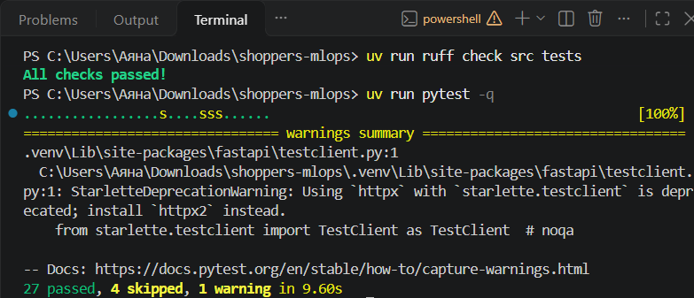
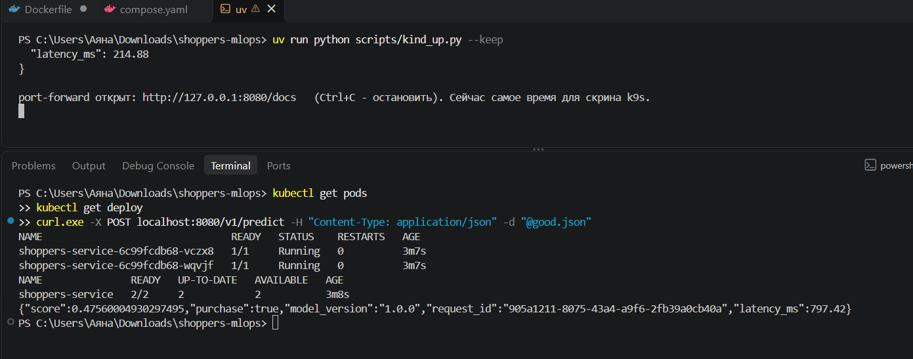
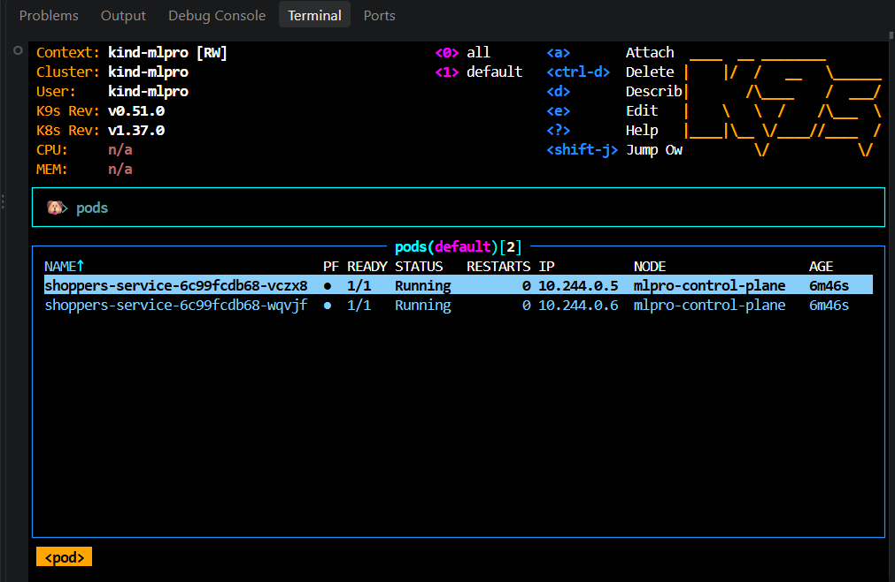

# shoppers-service: вероятность покупки в интернет-магазине

[](https://github.com/ab21b/shoppers-mlops/actions/workflows/ci.yml)

Random Forest на датасете [Online Shoppers Purchasing Intention](https://www.kaggle.com/datasets/imakash3011/online-shoppers-purchasing-intention-dataset)
в виде FastAPI-сервиса: логи запросов в Postgres, Docker/compose, Kubernetes (kind), CI/CD в GitHub Actions.
ROC-AUC на отложенном тесте 0.934, порог классификации 0.393.
Отчет по платформе, реестру моделей, DVC, HPA: [REPORT.md](REPORT.md). Отчет по предыдущим этапам: [REPORT_HW1_HW2.md](REPORT_HW1_HW2.md).

## Требования

Python 3.11, uv, Docker Desktop, kind, kubectl, k9s, Helm

После установки откройте терминал заново и проверьте: `uv --version`, `git --version`, `docker ps`, `kind --version`, `kubectl version --client`.
Порты 8000 (compose) и 8080 (port-forward kind) должны быть свободны.

## Проверка

```bash
git clone https://github.com/ab21b/shoppers-mlops.git && cd shoppers-mlops

uv run pytest                                  # 1. тесты
docker compose up -d --build                   # 2. compose: сервис + Postgres
uv run python scripts/kind_up.py               # 3. kind: две реплики, пробы, ответ модели через port-forward
```

Что должно получиться:

1. **Тесты:** все зеленые, интеграционные тесты с базой пропущены (`skipped`), потому что `DATABASE_URL` не задан.
2. **compose:** `docker compose ps` показывает `healthy` у `api` и `db`. После этого сервис слушает `localhost:8000` (`/docs`, `/health`, `/ready`, `/v1/predict`).
3. **kind:** скрипт собирает образ, создает кластер `mlpro`, загружает образ, создает секрет и базу, применяет `k8s/`, ждет rollout и печатает ответ модели, полученный через port-forward. `kubectl get pods` показывает две реплики `shoppers-service-...` в статусе `Running`.

В конце: `docker compose down -v` и `uv run python scripts/kind_up.py --delete`.

## Платформа, реестр моделей и деплой в свой кластер (дз 3)

Проверка из раздела выше (три команды) этого не требует: там модель берется из файла в образе. Ниже платформа,
в которой сервис получает модель из реестра MLflow по алиасу `champion`.

```powershell
uv run python platform/up.py                   # kind (порт 80), Traefik, MLflow, metrics-server; кластер mlops
```

Интерфейсы: <http://mlflow.localhost> (MLflow), <http://shoppers.localhost/docs> (сервис).
Если ОС не резолвит `*.localhost`, MLflow доступен и так: `kubectl --context kind-mlops -n mlops port-forward svc/mlflow 5000:5000` и `MLFLOW_TRACKING_URI=http://127.0.0.1:5000`.

Обучение и регистрация (каждый запуск создает версию в реестре; гейт решает, станет ли она `champion`):

```powershell
$env:MLFLOW_TRACKING_URI = "http://mlflow.localhost"
uv run dvc pull                                # данные из хранилища DVC (data/online_shoppers_intention.csv)
$env:MAX_DEPTH = "4";  uv run python -m shoppers.train   # первая версия -> champion
$env:MAX_DEPTH = "2";  uv run python -m shoppers.train   # хуже -> только challenger
$env:MAX_DEPTH = "11"; uv run python -m shoppers.train   # лучше на MIN_GAIN -> champion
```

Метрика гейта: PR-AUC, запас `GATE_MIN_GAIN=0.005` (см. REPORT.md). Каждый прогон логирует `data_md5`: md5 файла данных, он совпадает с md5 в `data/online_shoppers_intention.csv.dvc`.

Деплой в этот кластер делает GitHub Actions: job `deploy` идет на self-hosted runner (метка `kind`), запущенном в Docker в сети kind. Порядок и команды: REPORT.md, раздел «Как воспроизвести».

Откат модели без пересборки образа: в MLflow UI перевесить `champion` на прошлую версию, затем

```powershell
kubectl --context kind-mlops rollout restart deploy/shoppers-service
kubectl --context kind-mlops rollout status deploy/shoppers-service
curl.exe -H "Host: shoppers.localhost" http://127.0.0.1/health
```

Нагрузка и автомасштабирование (HPA, `k8s/hpa.yaml`):

```powershell
uv run --with locust locust -f locustfile.py --headless -u 60 -r 20 -t 4m --host http://127.0.0.1
kubectl --context kind-mlops get hpa -w
```

## Приложения

**pytest зеленый**



**SELECT из таблицы логов (после compose): строки 200 и 422**


**`kubectl get pods` и ответ `/v1/predict` через port-forward**



**k9s с подами сервиса**


