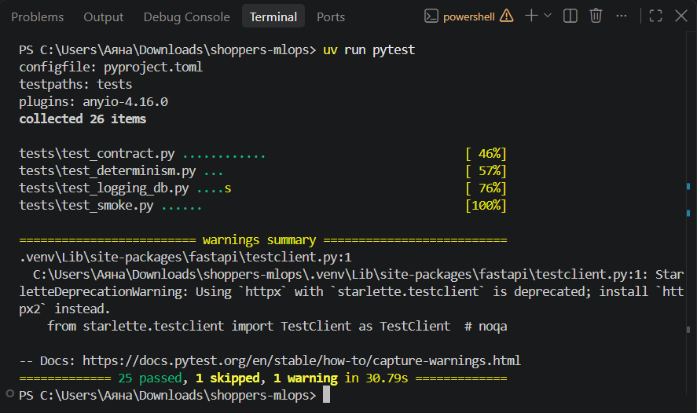
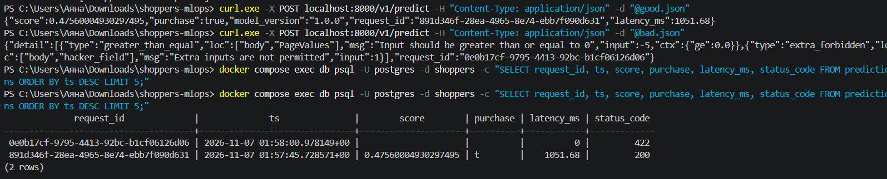
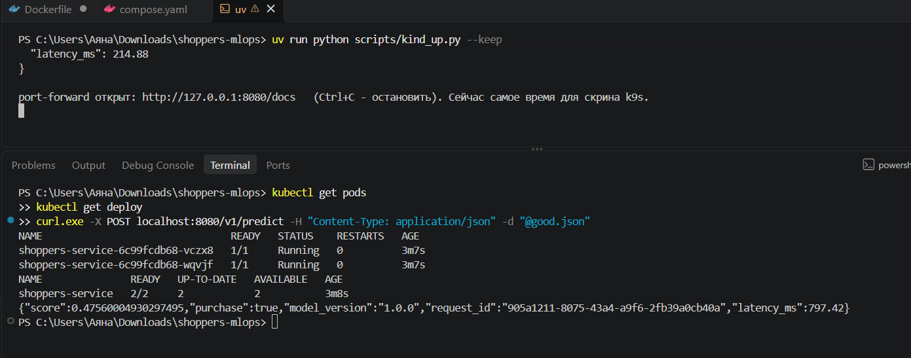
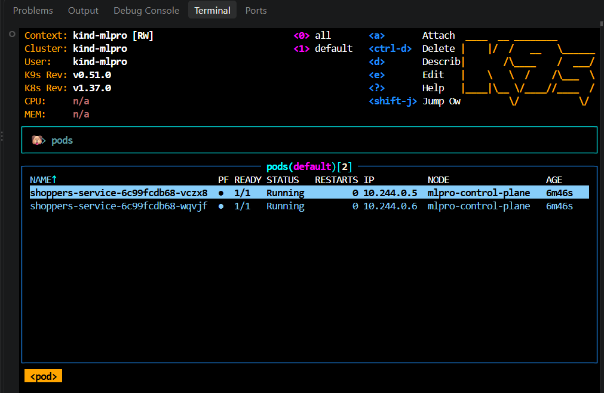

# Сервис для модели RandomForest


### Модель и паспорт

- Данные: 12330 строк, дубли удалены (12205), пропусков нет, доля покупок 15.6%.
- Pipeline одним объектом: `log1p` + median-imputer, `OneHotEncoder(handle_unknown="ignore")` для `Month, VisitorType, OperatingSystems, Browser, Region, TrafficType`. Препроцессинг внутри пайплайна: сервис получает сырые признаки.
- Метрики на тесте: ROC-AUC 0.9345, PR-AUC 0.7578, F1 0.6958, recall 0.7094.
- `metadata`: `model_version`, `features` (17 штук в порядке датасета), `threshold`, метрики, параметры, версия sklearn, дата.

### Схема запроса

17 фичей, `extra="forbid"`, границы из смысла и датасета: счётчики `ge=0`, доли `BounceRates/ExitRates/SpecialDay` в `[0, 1]`, `OperatingSystems 1..8`, `Browser 1..13`, `Region 1..9`, `TrafficType 1..20`, `Month` и `VisitorType` как `Literal` из значений датасета, `Weekend: bool`.

Про опциональные поля: в этом датасете пропусков нет, поэтому обязательны все поля. Для `SimpleImputer` тест проверяет, что NaN и незнакомая категория не роняют инференс.

Ограничение схемы: `Month` принимает только 10 месяцев из датасета (январь и апрель в данных нет), остальные дают 422.

### Логи

Таблица `predictions`: `request_id uuid PK, ts, model_version, features jsonb, score, purchase, latency_ms, status_code`.

- `status_code` (новое поле) пишется для всех запросов к `/v1/predict`: 200, 422 (валидация; в `features` сырое тело запроса, `score` пустой), 500 (сбой инференса).
- Без `DATABASE_URL` сервис работает и просто не логирует.


## 3. Скрины чекпоинтов


**1. pytest**  

```bash
uv run pytest
```



**2. SELECT из логов** После `docker compose up -d --build` специально один хороший и один плохой запрос:

```bash
curl -X POST localhost:8000/v1/predict -H "Content-Type: application/json" -d @good.json
curl -X POST localhost:8000/v1/predict -H "Content-Type: application/json" -d @bad.json
docker compose exec db psql -U postgres -d shoppers -c "SELECT request_id, ts, score, purchase, latency_ms, status_code FROM predictions ORDER BY ts DESC LIMIT 5;"
```



**3. get pods + ответ predict через port-forward**  Водном окне `uv run python scripts/kind_up.py --keep` (port-forward остается открытым), во втором окне:

```bash
kubectl get pods
kubectl get deploy
curl -X POST localhost:8080/v1/predict -H "Content-Type: application/json" -d @good.json
```




**4. k9s**  

```bash
k9s --context kind-mlpro
```



## 4. Журнал проблем

| # | Что не получилось | Ошибка | Решение |
|---|---|---|---|
| 1 | `docker compose up -d --build`: контейнер api не стартовал | Error response from daemon: failed to set up container networking: driver failed programming external connectivity on endpoint shoppers-mlops-api-1 (...): Bind for 0.0.0.0:8000 failed: port is already allocated | Был активен старый контейнер с прошлого запуска этого проекта пришлось снести его docker stop online_shoppers_mlops-api-1 online_shoppers_mlops-db-1|
| 2 | `SELECT ... FROM predictions`|  relation "predictions" does not exist| запросы уходили в старый api и писались в его базу. После освобождения порта и пересоздания стека таблица появилась |

---

# Домашняя работа 2. CI/CD

## 1. Сколько секунд шёл job build в первом прогоне и сколько во втором? Какой слой Dockerfile взят из кэша и почему именно он?

В первом 1 минуту 12 секунд https://github.com/ab21b/shoppers-mlops/actions/runs/43283718969 во втором 25 секунд https://github.com/ab21b/shoppers-mlops/actions/runs/43286944650. Все слои 11-17 имет статус CACHED. #13 [stage-0 5/8] RUN uv sync --frozen --no-dev --no-install-project
#13 CACHED Слой использовался с кэша так как файлы pyproject.toml, uv.lock и .python-version не изменились

## 2. В логе deploy во время выката видны поды в ImagePullBackOff, а прогон при этом зелёный. Откуда эти поды и почему это не ошибка?

отдельный проблемный Pod не обязательно означает, что весь Deployment неработоспособен.

## 3. Какой путь проходит пароль базы от страницы настроек GitHub до переменной окружения в поде? Почему его нельзя положить в configmap.yaml?

Пароль базы хранится в GitHub в разделе Actions под именем POSTGRES_PASSWORD. В workflow он передаётся через ${{ secrets.POSTGRES_PASSWORD }}, после чего используется для создания Kubernetes Secret с именем shoppers-db. Затем в k8s/deployment.yaml через secretKeyRef контейнер получает нужное значение в переменную окружения. Пароль нельзя хранить в configmap.yaml, поскольку ConfigMap предназначен для несекретных настроек, а для конфиденциальных данных Kubernetes предоставляет Secret.

## 4. Уберите мысленно needs: tests у job build. Опишите сценарий, в котором это закончится плохо.

Если убрать needs: tests, job build сможет выполняться независимо от результата тестирования. Например, если в коде обнаружится ошибка и pytest завершится неудачно, сборка Docker-образа всё равно может пройти и опубликовать образ в GHCR. В результате может быть опубликована и потенциально развёрнута версия приложения, которая не прошла проверки. Поэтому зависимость needs: tests нужна, чтобы сборка начиналась только после успешного завершения тестов.

## 5. Почему на pull request у вас бегут только тесты, а build и deploy нет? Какая строка за это отвечает и зачем так сделано?
if: github.event_name == 'push' && github.ref == 'refs/heads/main'
Тесты запускаются при событиях pull_request и push, поскольку для job tests нет ограничения только на основную ветку. Это сделано для того, чтобы проверять код на Pull Request, но не публиковать Docker-образы и не выполнять развёртывание до слияния изменений в основную ветку.

## 6. Зачем в init() стоит pg_advisory_xact_lock? Что произойдёт без него при двух репликах и пустой базе? Реплики чего именно здесь имеются в виду?
для синхронизации инициализации базы данных. Если база пустая и две реплики приложения запустятся одновременно, обе могут попытаться создать одну и ту же таблицу. Блокировка позволяет одной транзакции выполнить инициализацию первой, а второй дождаться её завершения, предотвращая гонку при создании схемы. Под двумя репликами здесь имеются в виду два Pod API-приложения, указанные в k8s/deployment.yaml, а не две реплики PostgreSQL.

## 7. В трёх ваших красных прогонах поды застряли в трёх разных статусах. Расположите эти статусы в порядке жизни пода и объясните, на каком шаге возникает каждый.
Pending — возникает на этапе планирования Pod, когда Kubernetes не может назначить его на узел с достаточными ресурсами. В нашем эксперименте это произошло из-за слишком большого запроса памяти.


CreateContainerConfigError — возникает на этапе подготовки контейнера, когда Kubernetes не может сформировать его конфигурацию. В нашем случае причиной стало обращение к несуществующему Secret.


CrashLoopBackOff — возникает после запуска контейнера, когда процесс приложения завершается с ошибкой и Kubernetes повторяет попытки его запуска. В нашем эксперименте приложение не смогло загрузить модель, поскольку путь оказался неверным.

## Ссылки 

- PR: https://github.com/ab21b/shoppers-mlops/pull/1
- Намеренно сломанный тест: красный run https://github.com/ab21b/shoppers-mlops/actions/runs/43281645555, исправление: зеленый run https://github.com/ab21b/shoppers-mlops/actions/runs/43282960588
- Неверный MODEL_PATH: https://github.com/ab21b/shoppers-mlops/actions/runs/43286944650 , исправление: https://github.com/ab21b/shoppers-mlops/actions/runs/43289325476. Как по логу понять причину: deploy завершился с ошибкой на шаге Deploy API, в разделе Diagnose failed deployment в секции Pods видно CrashLoopBackOff, под не отмечен как ready (0/1), в секции API pod diagnostics сообщение FileNotFoundError: [Errno 2] No such file or directory: 'artifact/nomodel.joblib'
- Неверный Secret reference: https://github.com/ab21b/shoppers-mlops/actions/runs/43290351504, исправление: https://github.com/ab21b/shoppers-mlops/actions/runs/43291659856. Логи: CreateContainerConfigError Warning  Failed     48s (x12 over 3m)  kubelet            Error: secret "shoppers-dbb" not found
- Невозможный memory request: (https://github.com/ab21b/shoppers-mlops/actions/runs/43292569698), исправление: https://github.com/ab21b/shoppers-mlops/actions/runs/43294316956. Логи: shoppers-service-68688d99df-9sg2n   ready: 0/1     status: Pending;
в Recent events видно Warning   FailedScheduling          pod/shoppers-service-68688d99df-9sg2n    0/1 nodes are available: 1 Insufficient memory.